### ⚡ About me

I build **web and mobile products end to end** — from the database schema to the last pixel.

- 🚀 **Next.js, React & Node.js** on the web · **React Native** on mobile
- 🛠️ Shipped dashboards, e-commerce stores, booking apps, invoicing tools and a Web3 NFT site
- 🧠 Solving DSA problems regularly → [`leetcode-problems`](https://github.com/Muhammad-Aman1718/leetcode-problems)
- 🌱 Leveling up in **System Design**, **Cloud** and **DevOps**

### 🧰 Tech stack

   
  

### 🚀 Featured projects

  
  
  
  

### 📊 GitHub at a glance

  
  
  
  

  <picture>
    <source media="(prefers-color-scheme: dark)" srcset="https://raw.githubusercontent.com/Muhammad-Aman1718/Muhammad-Aman1718/output/github-snake-dark.svg"/>
    <source media="(prefers-color-scheme: light)" srcset="https://raw.githubusercontent.com/Muhammad-Aman1718/Muhammad-Aman1718/output/github-snake.svg"/>
    
  </picture>

Cards are generated from live GitHub data every 6 hours by <a href=".github/workflows/snake.yml">a GitHub Action</a> in this repo.

